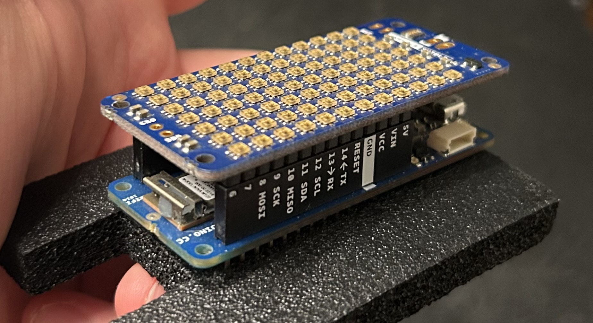
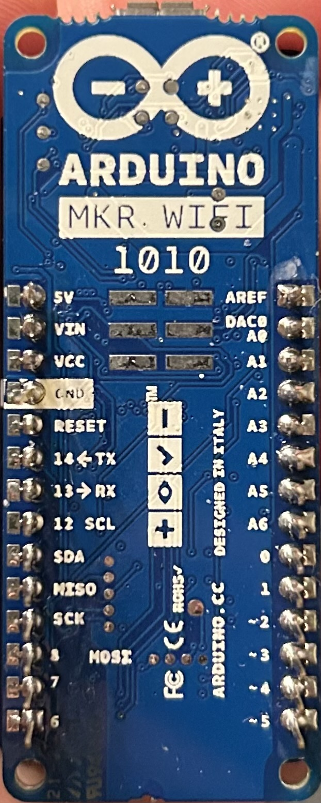
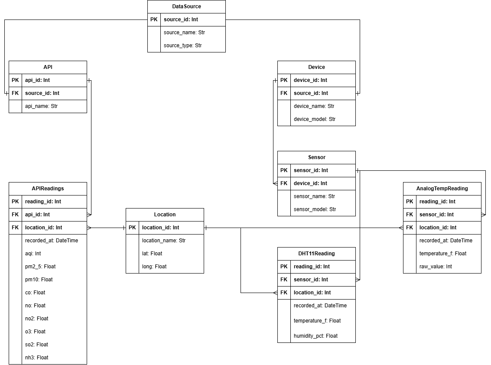

# Environmental Telemetry Platform

An environmental monitoring and data analytics project integrating Arduino hardware, Python, PostgreSQL, and environmental data sources using weather APIs and physical sensors. 

## Project Overview

This project builds upon my original Weather-Data prototype, developed using an Arduino MKR WIFI 1010, an RGB Shield, Python, SQLAlchemy, and PostgreSQL. 

The original implementation successfully collected air-quality data through the Arduino MKR WiFi 1010, displayed readings on the RGB Shield, and transferred data to PostgreSQL using Python and serial communication.

The current iteration focuses on developing a reliable, testable data ingestion pipeline that supports environmental monitoring, structured data storage, and analytics.

## Technology Stack
* **Hardware**: Arduino MKR WiFi 1010, RGB Shield, variety of environmental sensors 
* **Programming**: Python, Arduino C++
* **Database**: PostgreSQL, SQLAlchemy
* **Data Sources**: OpenWeather API, environmental sensors
* **Analytics**: SQL, Power BI

## How It Started
I originally started this project as a way to comine my interest in electronics and data. I wanted to build something that brought the two together. 

My first prototype used an Arduino MKR WiFi 1010 connected wirelessly to an environmental API. I programmed it to retrieve air quality readings and display them on an RGB shield. It wasn't particularly sophisticated, but I liked the idea of having a small display on my desk that could show the current air quality in my neighborhood.

**Original Arduino and RGP Shield Prototype**

In addition to displaying data, I wanted to collect and store it. 

Using Python, I established a serial connection between the Arduino and my computer, collected API readings transmitted by the Arduino, and stored them in PostgreSQL using SQLAlchemy. This gave me an opportunity to apply concepts I had learned in school.

Finally, I connected the database to Power BI and created a table visualization using the collected data. 

**Original Power BI Dashboard**

The original implementation wasn't polished, but it worked, and, most importantly, it demonstrated that I could collect data from physical hardware I coded in C++, transfer it through Python, store it in a relational database, and visualize the results. 

That experience is what inspired me to revisit and exapand it into a more complete platform, with a modular databse, additonal physical sensors, and a stronger focus on data engineering and analytics. 

## Current Architecture
**ERD** 

            

I redesigned the database to support multiple data sources, including APIs and physical devices.

Rather than storing everything in one table, I separated the data into related tables to make it easier to manage and expand. This also allows me to integrate additional sensors and APIs without having to redesign the entire database.

## Development Status
The repository currently contains the original Arduino sketches and the original Python implementation. 

### TODO:
* Restore and validate the existing ingestion pipeline
* Improve data processing and PostgreSQL integration
* Add error handling, logging, and automated tests
* Improve environmental data visualizations
* Integrate local environmental sensors

## Hardware
The original Arduino prototype displayed air-quality measurements and classifications on an RGB Shield.

A separate DHT11 prototype was developed to measure temperature and humidity.
hmm
Future development will explore combining these inputs into a unified environmental telemetry platform.